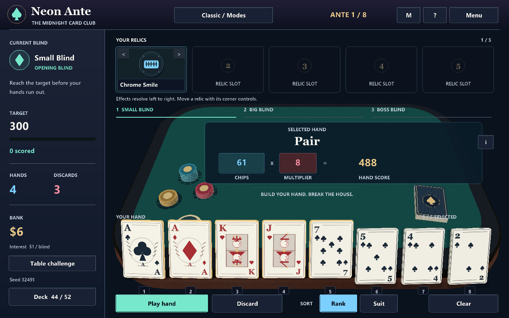
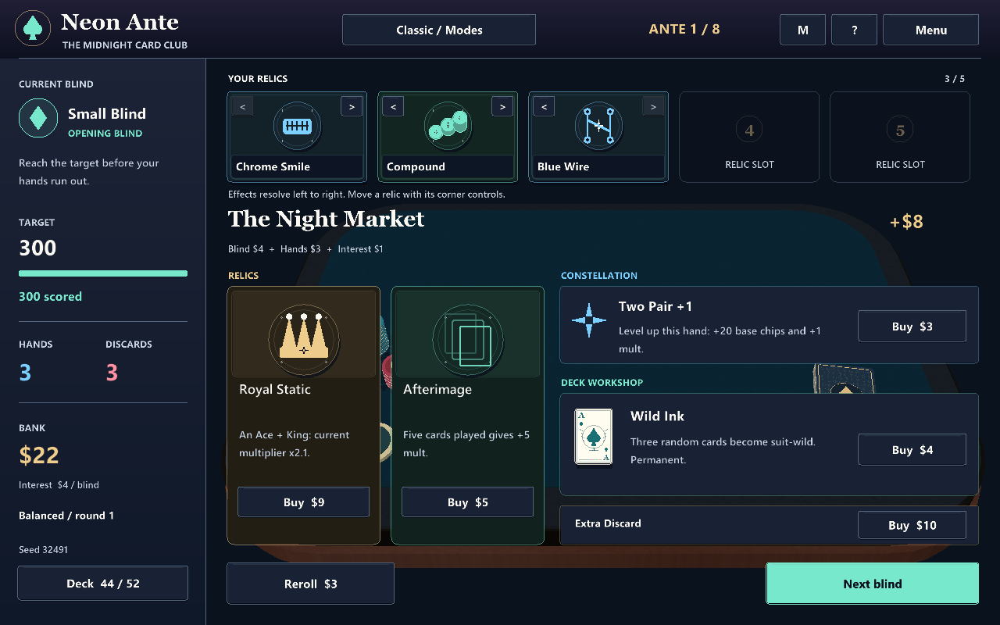
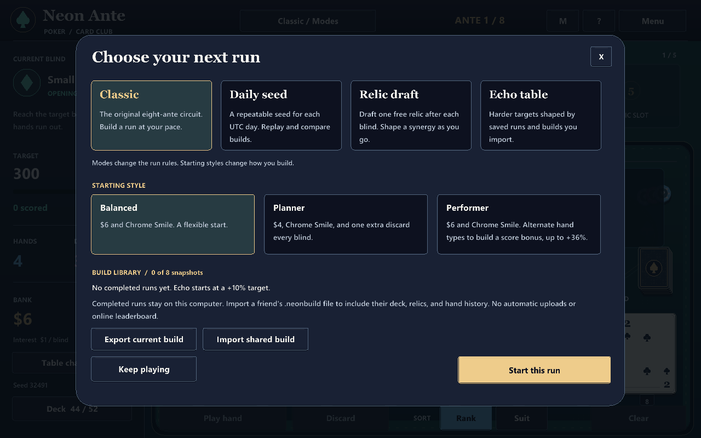

# Neon Ante Poker

A single-player poker roguelike for browsers and 64-bit Windows, built with C++17 and raylib.

## Play without building

**[Play Neon Ante in your browser](https://schwjh03.github.io/Neon-Ante-Poker/)**. Choose a game mode and starting style, then select **Start new run**, or use **Continue saved run** to return to your table. No installation or account is required.

For Windows, download the **[3D preview ZIP](https://github.com/schwjh03/Neon-Ante-Poker/raw/refs/heads/main/docs/downloads/Neon-Ante-Poker-3D-Preview-Windows-x64.zip)**, extract it, and run `NeonAntePoker.exe`. No installer or extra runtime download is required. The earlier 1.2.0 build remains under [Releases](https://github.com/schwjh03/Neon-Ante-Poker/releases). Source code archives are for developers, rather than the playable game.



Build poker hands, combine relics, and spend your winnings at the Night Market. Your run saves locally; no account is required. This is a single-player score game with no real-money wagering.




The browser edition compiles the same C++ engine and rendered game to WebAssembly. It includes all four modes, starting styles, market upgrades, challenges, drafting, and ordered relic effects. Browser saves and the build library stay in this browser on this device; clearing site data removes them. Windows saves remain separate. Use Export build / Import build to share a deck snapshot deliberately. A larger screen or landscape view gives the table more room.

The browser always opens at the title menu. It validates your save before showing Continue, shows a summary of the saved table, and asks before a new run replaces it. The table is paused while the title menu is open. Use **Main menu** above the table to save and return to your choices.

## Run modes and starting styles



Open **Modes** in the top bar. The current run is replaced only after you confirm.

- **Classic:** the original eight-ante circuit.
- **Daily Seed:** the same deterministic seed for each UTC day. Starting style and decisions still change the run; there is no online leaderboard.
- **Relic Draft:** choose one free relic after every cleared blind, or pass. Shop rerolls do not refresh the draft.
- **Echo Table:** harder targets based on strong completed builds in the local library, including `.neonbuild` files you deliberately import. A profile's favored hand receives a visible score penalty. Difficulty is capped.

Choose **Balanced**, **Planner**, or **Performer**. Planner starts with less cash and an extra discard. Performer builds a score bonus by alternating hand types.

The build library keeps up to eight strong snapshots from finished runs. Export your current deck, relic order, hand levels, and usage through the mode picker; import a shared file through the same screen. Files are validated before use. Nothing is uploaded automatically, and this is not a community-wide learning service.

## The Night Market

Relics, constellations, the deck workshop, and vouchers have their own areas. Relics add effects, constellations level up hand categories, and the workshop permanently modifies cards. Click an owned relic to see its details or sell it in the market.

**Relics resolve from left to right.** Use the corner controls on the relic slots, or Move Left / Move Right in the detail panel. An additive multiplier bonus before a multiplier effect produces a different result from placing it afterward. The live preview and scoring breakdown follow the actual slot order. The multiplier can be fractional.

Before your first play or discard in each blind, the **Table Challenge** button offers an optional payout condition. Challenges include a first-hand clear, varied hand types, a small final hand, no discards, or a score over the target. A challenge can be chosen once per blind; it does not impose a cash entry fee.

## The 3D table

The main branch now renders original rounded and extruded meshes for the table, leather rail, wooden base, chips, deck, and playing cards. Cards lift when selected and tilt on hover. A texture atlas keeps the existing rank, suit, enhancement, and debuff artwork accurate while readable controls remain in 2D.

Directional material lighting, contact shadows, and generated felt, leather, and wood textures give the objects depth. The table and hand are rendered to separate textures outside the main UI pass; unchanged passes are cached. Browser pointer presses are queued until a frame consumes them. The hand camera uses its own near plane to keep thin card layers distinct on WebGL, then restores the previous clipping distances.

See `src/drawing/scene3d.cpp`. The models and surface textures are generated by this project; no external model pack is required. This is a hybrid 3D table with a 2D interface.

## The Run

Beat Small, Big, and Boss blinds across eight antes. Select one to five cards from your eight-card hand. The poker category supplies base chips and a multiplier; every played card adds chips, then your relics apply. Reach the target before your hands run out.

The Night Market offers 16 different relics in a dedicated section, hand-level upgrades, permanent card enhancements, extra hands, and extra discards. Carry up to five relics; click an owned relic in the shop to sell it. Money left in your bank earns $1 interest per $5, capped at $5 per cleared blind. Win ante eight to unlock endless play.

Your enhanced deck survives between blinds. Foil adds 35 chips, wild cards match suits for flushes, and the forge raises card ranks. Number cards contribute their rank, face cards contribute 10, and Aces contribute 11. Aces count high or low in straights, but are not face cards. Hearts debuffed by Redout contribute neither card chips nor card-triggered relic bonuses.

## Controls

- Click a card, or press **1-8**, to select it. Up to five may be selected.
- **Enter** plays; **Backspace** discards.
- **R** sorts by rank; **S** sorts by suit.
- Right-click clears the selection.
- **Tab** opens the deck; **H** opens the hand reference.
- **M** toggles sound. On Windows, **F11** toggles borderless fullscreen; in the browser, use the Fullscreen button.
- **Escape** opens/closes menus. Actions save the run automatically.
- The **i** button beside a hand opens its scoring breakdown.

Windows runs save automatically after actions to `%LOCALAPPDATA%\NeonAntePoker\run-v2.save`. Browser runs use local browser storage. Relaunching resumes the run. New Run requires confirmation. Browser and Windows editions do not sync saves automatically.

## Build

The source and pinned third-party dependencies are included. Use the MSYS2 UCRT64 toolchain with `mingw-w64-ucrt-x86_64-gcc` installed. The script checks PATH and then the standard `C:\msys64\ucrt64\bin` location. The included raylib library is built for Windows x64 MinGW-w64.

From PowerShell in this folder:

```powershell
.\build.ps1
.\build\NeonAntePoker.exe
```

The build is offline. `build.ps1` compiles the poker evaluator, links the graphics library and C++ runtime statically, and writes the game to `build\NeonAntePoker.exe`. Runtime DLL dependencies are Windows system libraries only. The application uses installed Segoe UI Semibold and Georgia fonts, with a built-in font fallback, and generates its card art and sound effects in code.

## Build the browser edition

Install and activate the official [Emscripten SDK](https://emscripten.org/docs/tools_reference/emsdk.html) **4.0.7** into `build/emsdk`, including its bundled Python and Node, and obtain official [raylib 5.5](https://github.com/raysan5/raylib/tree/5.5) sources in `build/raylib-src`. The tested raylib commit is `c1ab645ca298a2801097931d1079b10ff7eb9df8`. The SDK and graphics sources are build tools, excluded from this repository. The fonts, font licenses, shell, and game source are included.

```powershell
.\build-web.ps1 -TestEngine
```

The script uses the SDK's local configuration and outputs `docs/index.html`, `neon.js`, `neon.wasm`, and `neon.data`, plus the shell assets and licenses. Custom SDK and raylib paths can be passed with `-Emsdk` and `-Raylib`. Serve `docs/` over HTTP; opening its HTML as a local file will not load WebAssembly assets. GitHub Pages uses **main /docs**. No backend, analytics, account system, or external runtime service is required.

The browser uses openly licensed Atkinson Hyperlegible and Libre Baskerville fonts, and user-activated WebAudio for synthesized sound. Its save adapter stores one localStorage envelope after actions. Imported files pass the same build validation as Windows.

## Verification

```powershell
.\build.ps1 -Test
```

The tests also check mode saves, deterministic daily deals, one-time challenge payouts, draft ownership and gating, shared-build validation, adaptive difficulty bounds, legacy save migration, and score changes caused by relic reordering.

The test suite checks every standard five-card hand (2,598,960 combinations) against the known category frequencies. Additional checks cover ace-low straights, wild suits, forged cards, relic bonuses, boss restrictions, score previews, loss/victory, endless mode, shop transactions, enhancement persistence, and save/load behavior.

An in-process graphical smoke test clicks the actual rendered controls through selection, scoring, shop purchases, rerolling, advancing, discarding, deck/reference views, and new-run cancellation. It uses a deterministic temporary run without changing your save. Its results are written to `build\ui-smoke.txt`.

Screenshots can be generated without changing your save:

```powershell
.\build\NeonAntePoker.exe --capture table.png
.\build\NeonAntePoker.exe --capture shop.png --scene shop
.\build\NeonAntePoker.exe --capture small.png --scene selected --small
```

## Source Map

`main.cpp` only calls `runApplication()`. Start with [docs/CODE_STRUCTURE.md](docs/CODE_STRUCTURE.md) for the file tree, frame flow, and a guide to common edits.

- `src/runtime.cpp`: window setup, command-line options, and frame loop.
- `src/web_runtime.cpp`, `src/web_platform.cpp`: browser frame loop, local saves, and build import/export.
- `web/`, `build-web.ps1`: browser shell, licensed fonts, and WebAssembly build.
- `src/app.hpp`, `src/app.cpp`: application state, keyboard input, animations, and screen dispatch.
- `src/screens/`: separate table, shop, HUD, end screen, and dialog implementations.
- `src/ui.hpp`, `src/ui.cpp`, `src/drawing/`: fonts, pointer state, reusable controls, and card/relic artwork.
- `src/drawing/scene3d.cpp`: original model geometry, materials, card atlas, and cached 3D passes.
- `src/theme.hpp`: shared colors and canvas dimensions.
- `src/game.hpp`, `src/game.cpp`: run state, drawing cards, playing hands, and blind progression.
- `src/engine/`: game content, poker classification, scoring, shop rules, and save serialization.
- `src/audio.hpp`, `src/audio.cpp`: synthesized sound effects through Windows audio.
- `src/preview.cpp`: sample scenes for screenshots.
- `tests/`: engine regression tests and graphical smoke-test steps.
- `vendor/`: dependencies and their licenses. See `THIRD_PARTY.md`.

The `.clang-format` file defines the project's four-space indentation and 100-column style. A formatter is optional and is not required to build the game. Version-1 saved runs migrate into Classic on first launch; the original run.save is retained, and the new version uses run-v2.save. Version-2 saves include mode, starting style, challenges, drafting, build history, and relic order. The older v1.0 executable cannot read the new save format.

The poker rules are a custom single-player score-chasing variant, not a multiplayer betting simulator. This is an original game inspired by poker roguelikes; it contains no Balatro assets or code.

### Readability and visual update (1.2)

Labels use a 16px minimum at the 1280×800 game canvas; descriptions use at least 18px. Body text uses Segoe UI Semibold, and dim labels have brighter contrast. The table includes stitched felt, a dealer chip, chip stacks and a draw deck. Every relic now has its own emblem. All visuals are drawn locally in code; no network or asset download is needed.
